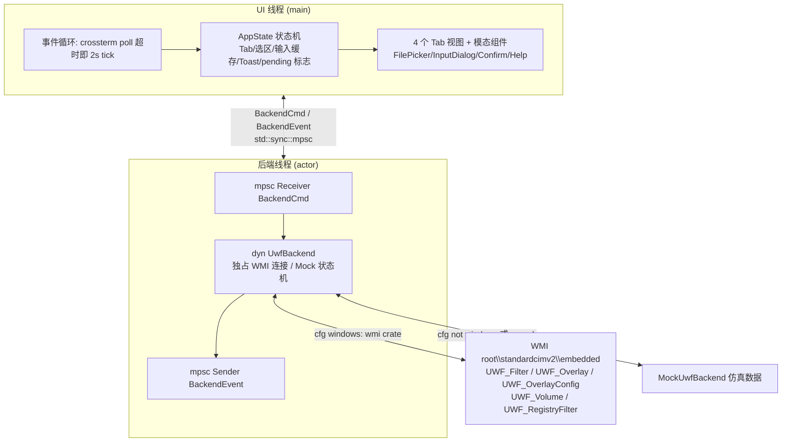

# UWF Manager (Rust 1.99 TUI) 重写方案设计 v2

> 本文档为将 C# WinForms 项目 `UWFPRO` 重构为 Rust 1.99 终端用户界面（TUI）应用 `uwf_manager` 的详细技术设计与实施方案。

**v2 修订说明**（基于对原 C# 项目 2052 行源码的逐项核对与依赖联网核实）：
1. 补齐功能遗漏：**排除项列表导入/导出**（原版 `MainForm.cs:306,328`）。
2. 新增"关键业务规则"一节：Overlay 锁定规则、Protect/Commit 的会话语义、删除提交两步语义等，均附原版代码证据。
3. 技术选型收敛：依赖全部更新至 2026-10 最新稳定版并双 target 实测；**WMI 驱动改用 `wmi` crate（serde 化）**；**移除 tokio/crossbeam**，改双线程 + `std::sync::mpsc` 模型。
4. UAC 策略、UWF 未安装行为、界面语言三项待确认问题全部拍板。
5. 新增"与原版的差异与有意省略"清单，保证可追溯性。

---

## 1. 目标与背景

### 1.1 背景
原项目 [UWFPRO](file:///home/gewei/UWFPRO) 是基于 C# WinForms 的 Windows 统一写入筛选器（UWF）图形化管理工具，通过 WMI（`root\standardcimv2\embedded`）管理 UWF 筛选器、Overlay 缓存、卷保护、文件/注册表排除项与持久化提交（Commit）。

### 1.2 重写目标
使用 **Rust 1.99（Edition 2024）** 将其重构为单可执行文件、零运行时依赖（无 .NET/无 tokio 异步运行时）的 TUI 工具 `uwf_manager`：

- **功能对齐**：UWF 开关、Overlay 容量/阈值配置与 2 秒动态监测、卷保护切换、排除项管理（文件/注册表、当前/下次双视图）、**排除列表导入/导出（txt）**、文件提交/删除提交、注册表提交。
- **现代化 TUI**：`ratatui` + `crossterm`，Tab 分栏、Table/List 导航、Gauge 容量条、模态弹窗、内置文件选择器。
- **跨平台可开发**：`UwfBackend` Trait 抽象；Windows 走 `wmi` crate 原生驱动，Linux/macOS 走 Mock 仿真数据，`cargo run` 即可预览全部界面。
- **自动化提权**：Windows 二进制内嵌 `requireAdministrator` UAC 清单。
- **代码优雅**：无 `unsafe`（WMI 交互由 `wmi` crate 封装）、无异步运行时、统一中文错误文案、文本常量集中管理。

---

## 2. 最终技术决策 (Finalized Decisions)

> 本节取代 v1 的"待用户审阅/待确认问题"，全部决策已定案。

| # | 决策 | 结论与理由 |
| :--- | :--- | :--- |
| **D1** | 后端抽象 | 定义 `UwfBackend` Trait；`#[cfg(windows)]` → `WindowsWmiBackend`，其余平台 → `MockUwfBackend`。另提供 `--mock` 启动参数，Windows 上也可强制 Mock 预览（免管理员、免 UWF 环境）。 |
| **D2** | 并发模型 | **不引入 tokio/crossbeam**。全程序仅 2 个线程：UI 线程（crossterm `event::poll` + 2 秒 tick）+ 后端线程（`std::sync::mpsc` 消息循环独占 WMI 连接）。2 秒轮询由 UI tick 发送刷新命令实现。 |
| **D3** | WMI 驱动选型 | **采用 `wmi` 0.18 crate**（而非裸 `windows` crate 手写 COM 胶水）。理由：① serde 化查询（`con.query::<UWF_Filter>()`）与方法调用（`exec_instance_method`，入参 `Serialize`、出参 `Deserialize`），消灭全部 VARIANT/SAFEARRAY 手工胶水；② COM 初始化与安全策略由 crate 托管；③ **运行时依赖不含 tokio**（tokio 仅为其 dev-dependency）；④ 底层即 `windows` 0.62，必要时可同模块内降级裸调。本机已在 `x86_64-unknown-linux-gnu` 与 `x86_64-pc-windows-gnu` 双 target 实测编译通过。 |
| **D4** | COM 线程模型 | `wmi::WMIConnection` 为 `!Send + !Sync`（COM 套间约束），因此**后端线程独占连接**（actor 模式），UI 通过 channel 收发命令/事件，天然规避全部套间与 `Send/Sync` 问题。 |
| **D5** | UAC 策略 | manifest 使用 `requireAdministrator`（与原版一致）。已知行为：从非提权终端启动时，UAC 确认后进程在**新控制台窗口**运行（Windows 机制使然，写入使用手册）。另加运行时 `TokenElevation` 检测兜底：非管理员（如无 manifest 的 dev 构建）打印中文引导并以退出码 2 退出。 |
| **D6** | UWF 未安装行为 | **不退出**。进入 TUI 引导页，显示启用命令与说明：`Enable-WindowsOptionalFeature -Online -FeatureName Client-UnifiedWriteFilter`（管理员 PowerShell 执行，重启后生效）。 |
| **D7** | 界面语言 | 纯中文，所有文案集中于 `ui/text.rs` 常量层（预留未来 i18n 可能，不实现双语切换）。 |
| **D8** | 与原版差异 | 见 §6.6 差异清单：4 项原版"有实现但 UI 未接线"的能力接入 UI；5 项空壳/损坏能力有意省略并登记。 |

---

## 3. 技术选型与依赖

版本均为 **2026-10-16 crates.io 最新稳定版**，已在本机（rustc 1.99.0）双 target 实测通过编译：

| 模块 | 选型 | 锁定版本 | 说明 |
| :--- | :--- | :--- | :--- |
| 语言 | Rust | 1.99.0 (Edition 2024) | 本机工具链 stable 1.99.0 (2026-09-28) |
| TUI 核心 | `ratatui` | **0.30.2** | features = `["crossterm_0_29"]`（后端经 `ratatui-crossterm 0.1` 提供） |
| 终端后端 | `crossterm` | **0.29.0** | 兼容 Windows Terminal / ConPTY |
| WMI 驱动 | `wmi` | **0.18.4** | 仅 Windows target；`default-features = false`（去掉 chrono） |
| Win32 API | `windows` | **0.62.2** | 仅 Windows target；提权检测等少量裸调 |
| 序列化 | `serde` | **1.0** | 仅 Windows target（wmi 出入参结构体 derive） |
| 错误处理 | `thiserror` | **2.0** + `anyhow` **1.0** | 业务错误枚举（中文 Display）+ main 边界 |
| 时间格式化 | `chrono` | **0.4** | `default-features = false, features = ["clock"]`，仅用于导出文件名时间戳 |
| UAC 清单注入 | `embed-resource` | **3.0.12** | build-dependencies；替代已停更 5 年的 winres |

```toml
# Cargo.toml 骨架（版本号经 cargo 解析实测）
[package]
name = "uwf_manager"
version = "0.1.0"
edition = "2024"

[dependencies]
ratatui = { version = "0.30", features = ["crossterm_0_29"] }
crossterm = "0.29"
thiserror = "2"
anyhow = "1"
chrono = { version = "0.4", default-features = false, features = ["clock"] }

[target.'cfg(windows)'.dependencies]
wmi = { version = "0.18", default-features = false }
serde = { version = "1", features = ["derive"] }
windows = { version = "0.62", features = [
    "Win32_Foundation", "Win32_Security", "Win32_UI_Shell", "Win32_System_Threading",
] }

[build-dependencies]
embed-resource = "3"   # build.rs 内按 CARGO_CFG_TARGET_OS == "windows" 条件执行
```

> 编码注意：Edition 2024 中 `gen` 为保留关键字，命名一律避开（如 `generation`）。

---

## 4. 整体架构



要点：
- **UI 永不阻塞**：所有 WMI 调用都在后端线程执行；UI 发出命令后置 `pending`，收到 `BackendEvent` 后更新状态并弹 Toast。
- **2 秒监测**：UI 线程本地计时，每 2 秒发 `BackendCmd::RefreshOverlayRuntime`，回复仅更新 Overlay 区域。
- 同一时刻只允许一条变更类命令在途（查询类可并发入队），Mock 下即时回包，Windows 下 WMI 调用耗时也可感知。

---

## 5. 项目结构

```text
uwf_manager/
├── Cargo.toml
├── build.rs                    # 仅 windows target: embed-resource 编译 uwf_manager.rc
├── app.manifest                # requireAdministrator UAC 清单
├── uwf_manager.rc              # 资源脚本: manifest + 图标
├── icon.ico                    # 应用图标（复用原项目 UWF.ico）
├── PLAN.md
└── src/
    ├── main.rs                 # 入口: --mock 解析、终端初始化/恢复、panic hook、主事件循环
    ├── app.rs                  # AppState + 动作路由（纯函数式 reducer，可单测）
    ├── error.rs                # UwfError（thiserror，中文 Display）
    ├── model/
    │   ├── mod.rs
    │   ├── filter.rs           # FilterState { current_enabled, next_enabled }
    │   ├── overlay.rs          # OverlayType{Ram=0,Disk=1}, OverlayConfig, OverlayRuntime
    │   ├── volume.rs           # VolumeInfo { drive_letter, current_protected, next_protected }
    │   └── exclusion.rs        # FileExclusion, RegistryExclusion
    ├── backend/
    │   ├── mod.rs              # UwfBackend Trait + BackendCmd/BackendEvent + 线程启动
    │   ├── mock.rs             # MockUwfBackend（全平台，含下次会话状态机）
    │   └── windows/            # #[cfg(windows)]
    │       ├── mod.rs          # WindowsWmiBackend（wmi crate，实现全部 trait 方法）
    │       ├── classes.rs      # serde 查询行/出入参结构体（UWF_* 类映射）
    │       └── elevate.rs      # TokenElevation 提权检测
    └── ui/
        ├── mod.rs              # 布局主框架（Header/Tabs/Body/StatusBar/Toast）
        ├── theme.rs            # 颜色与样式
        ├── text.rs             # 全部中文文案常量
        ├── views/
        │   ├── dashboard.rs    # Tab 1: 状态概览
        │   ├── volumes.rs      # Tab 2: 卷保护 Table
        │   ├── exclusions.rs   # Tab 3: 排除项双栏（文件 | 注册表）
        │   └── commit.rs       # Tab 4: 提交工具
        └── components/
            ├── file_picker.rs  # 模态文件/目录浏览器（盘符切换、目录展开）
            ├── input_dialog.rs # 通用输入弹窗
            ├── confirm.rs      # 危险操作确认（重置/重启/关机/删除提交）
            └── help.rs         # [?] 快捷键帮助弹窗
```

---

## 6. 核心设计

### 6.1 `UwfBackend` Trait（`src/backend/mod.rs`）

方法全部 `&mut self`（Mock 需要可变状态；WMI 实现内部无状态），`Send` 以满足跨线程转移：

```rust
use crate::error::Result;
use crate::model::*;

pub trait UwfBackend: Send + 'static {
    // ── Filter（单实例，无会话分裂）──
    fn get_filter_state(&mut self) -> Result<FilterState>;
    fn enable_filter(&mut self) -> Result<()>;      // 下次启动生效（R1 同）
    fn disable_filter(&mut self) -> Result<()>;
    fn reset_settings(&mut self) -> Result<()>;     // 重置全部 UWF 配置，下次启动生效
    fn restart_system(&mut self) -> Result<()>;
    fn shutdown_system(&mut self) -> Result<()>;

    // ── Overlay ──
    fn get_overlay_config(&mut self, current_session: bool) -> Result<OverlayConfig>;
    fn get_overlay_runtime(&mut self) -> Result<OverlayRuntime>; // 2s 轮询目标
    /// R1: 筛选器"当前已启用"时必须拒绝并返回中文错误（仅阈值不受限）
    fn set_overlay_type(&mut self, overlay_type: OverlayType) -> Result<()>;
    fn set_overlay_max_size(&mut self, size_mb: u32) -> Result<()>;
    fn set_warning_threshold(&mut self, size_mb: u32) -> Result<()>;
    fn set_critical_threshold(&mut self, size_mb: u32) -> Result<()>;

    // ── Volume ──
    /// 合并 current/next 两次查询（R2）
    fn list_volumes(&mut self) -> Result<Vec<VolumeInfo>>;
    /// R2: 作用于"下次会话"实例
    fn protect_volume(&mut self, drive_letter: &str) -> Result<()>;
    fn unprotect_volume(&mut self, drive_letter: &str) -> Result<()>;
    /// R3: 作用于"当前会话"实例
    fn commit_file(&mut self, drive_letter: &str, file_rel_path: &str) -> Result<()>;
    /// R3: 两步语义——先真实删除文件（容忍 NotFound），再调 WMI 固化删除；作用于"下次会话"实例
    fn commit_file_deletion(&mut self, drive_letter: &str, file_rel_path: &str) -> Result<()>;

    // ── Exclusion ──
    fn get_file_exclusions(&mut self, current_session: bool) -> Result<Vec<FileExclusion>>;
    /// R4: 增删作用于"下次会话"实例
    fn add_file_exclusion(&mut self, drive_letter: &str, file_rel_path: &str) -> Result<()>;
    fn remove_file_exclusion(&mut self, drive_letter: &str, file_rel_path: &str) -> Result<()>;
    fn get_registry_exclusions(&mut self, current_session: bool) -> Result<Vec<String>>;
    fn add_registry_exclusion(&mut self, key: &str) -> Result<()>;
    fn remove_registry_exclusion(&mut self, key: &str) -> Result<()>;
    /// R5: 当前会话实例；key/value 由 app 层按最后一个 '\\' 拆分后传入
    fn commit_registry(&mut self, key: &str, value_name: &str) -> Result<()>;
}
```

> 导入/导出**不进入 trait**：由后端线程内组合现有方法实现（导入 = 逐行解析 + 循环 add；导出 = 查询当前视图列表 + 写文件），见 §6.5。

### 6.2 关键业务规则（均附原版证据，实现与测试必须遵守）

| # | 规则 | 原版证据 |
| :--- | :--- | :--- |
| **R1** | 筛选器**当前已启用**时，Overlay 类型与最大容量不可修改（UI 置灰 + backend 校验返回中文错误）；预警/临界阈值**随时可改**。 | `MainForm.cs:77`（禁用输入）、`MainForm.cs:151`（仅 `CurrentEnabled == false` 才 SetMaximumSize） |
| **R2** | Protect/Unprotect 作用于**下次会话**实例。原版 hack 是把当前会话实例的 `CurrentSession` 属性置 `"False"` 再 `Put()`；Rust 版改为直接 `WHERE CurrentSession = False` 查询后调用，语义相同且干净。`list_volumes` 需 current/next 两次查询按盘符合并。 | `UWF_Volume.cs:119,151`、`MainForm.cs:GetVolumeList` 双字典合并 |
| **R3** | CommitFile → **当前会话**实例；CommitFileDeletion → **下次会话**实例（删除固化为延迟生效语义），且**先 `fs::remove_file` 真实删除文件**（容忍 NotFound）再调 WMI。 | `MainForm.cs:button_file_commit_Click`（CurrentSession）、`button_delete_commit_Click`（NextSession）、`UWF_Volume.cs:80`（先 `File.Delete`） |
| **R4** | 文件/注册表排除项的**增删**作用于下次会话实例；**查询**支持当前/下次双视图。 | `MainForm.cs:button_file_addexclusion_Click`（NextSession）、`button_ExclusionList_current/Next_Click` |
| **R5** | 注册表提交：用户输入完整路径（如 `HKLM\SOFTWARE\X\Value`），app 层按最后一个 `\` 拆为 `RegistryKey` + `ValueName`，作用于当前会话实例。 | `UWF_RegistryFilter.cs:64-74`、`MainForm.cs:button_regedit_commit_Click`（Current） |
| **R6** | 文件类 WMI 参数拆分：绝对路径 → 盘符（`C:`）+ 相对路径（去掉前 2 字符、保留前导 `\`，如 `\Windows\a.txt`）。 | `UWF_Volume.cs:FileName.Remove(0, 2)` 各处 |
| **R7** | Overlay 用量条以 `OverlayConsumption / MaximumSize` 计算（剩余空间单独显示 `AvailableSpace`），不采用 `MaxSize - AvailableSpace` 推算（磁盘型 Overlay 下不准）。 | `UWF_Overlay.cs:Get_Value` 字段集 |

### 6.3 C# → Rust WMI 调用映射表

| 原版（UWFCMD） | WMI 类 / 方法 | Rust trait 方法 |
| :--- | :--- | :--- |
| `UWF_Filter.Get_Value` | `SELECT * FROM UWF_Filter`（Id, CurrentEnabled, NextEnabled） | `get_filter_state` |
| `UWF_Filter.Enable/Disable/ResetSettings/ShutdownSystem/RestartSystem` | 单例实例方法 | `enable_filter` / `disable_filter` / `reset_settings` / `shutdown_system` / `restart_system` |
| `UWF_Overlay.Get_Value` | `SELECT * FROM UWF_Overlay`（AvailableSpace, Consumption, 双阈值） | `get_overlay_runtime` |
| `UWF_Overlay.SetWarningThreshold/SetCriticalThreshold(size)` | 实例方法 | `set_warning_threshold` / `set_critical_threshold` |
| `UWF_OverlayConfig.Get_Value/SetType/SetMaximumSize` | `UWF_OverlayConfig WHERE CurrentSession=..`；写操作取 next 实例 | `get_overlay_config` / `set_overlay_type` / `set_overlay_max_size` |
| `UWF_Volume.GetDriverLetters` | `UWF_Volume WHERE CurrentSession=True/False`（DriveLetter, Protected）×2 合并 | `list_volumes` |
| `UWF_Volume.Protect/Unprotect` | **next 会话实例**方法 | `protect_volume` / `unprotect_volume` |
| `UWF_Volume.GetExclusions` → `ExcludedFiles[]` | 逐卷实例方法 | `get_file_exclusions` |
| `UWF_Volume.AddExclusion/RemoveExclusion(FileName)` | next 会话实例方法 | `add_file_exclusion` / `remove_file_exclusion` |
| `UWF_Volume.CommitFile/CommitFileDeletion(FileName)` | 分别作用于 current / next 会话实例（R3） | `commit_file` / `commit_file_deletion` |
| `UWF_RegistryFilter.GetExclusions` → `ExcludedKeys[]` | 实例方法（按 CurrentSession 过滤） | `get_registry_exclusions` |
| `UWF_RegistryFilter.AddExclusion/RemoveExclusion(RegistryKey)` | next 会话实例方法 | `add_registry_exclusion` / `remove_registry_exclusion` |
| `UWF_RegistryFilter.CommitRegistry(RegistryKey, ValueName)` | current 会话实例方法 | `commit_registry` |

### 6.4 Windows 后端实现要点（wmi crate）

```rust
// 连接（COM 初始化与安全策略由 crate 托管）
let con = WMIConnection::with_namespace_path("root\\standardcimv2\\embedded")?;

// 查询：结构体名即 WMI 类名；__Path 为实例方法调用所需
#[derive(Deserialize)]
#[allow(non_snake_case)]
struct UWF_Filter {
    #[serde(rename = "__Path")] path: String,
    CurrentEnabled: bool,
    NextEnabled: bool,
}
let rows: Vec<UWF_Filter> = con.query()?;   // UWF 未安装 → 查询为空/连接失败 → D6 引导页

// 带会话过滤的查询
let vols: Vec<UWF_Volume> =
    con.raw_query("SELECT * FROM UWF_Volume WHERE CurrentSession = False")?;

// 无参实例方法
let out: MethodOut = con.exec_instance_method::<UWF_Filter, _>(&rows[0].path, "Enable", ())?;

// 带参实例方法：入参 Serialize、出参 Deserialize（字段名与 WMI 参数名一致）
#[derive(Serialize)] #[allow(non_snake_case)]
struct SizeParam { size: u32 }
#[derive(Deserialize)] #[allow(non_snake_case)]
struct MethodOut { ReturnValue: u32 }
let _: MethodOut = con.exec_instance_method::<UWF_Overlay, _>(&path, "SetWarningThreshold", SizeParam { size: 1024 })?;

// GetExclusions：出参含嵌入对象数组
#[derive(Deserialize)] #[allow(non_snake_case)]
struct ExclusionsOut { ReturnValue: u32, ExcludedFiles: Option<Vec<ExcludedFile>> }
#[derive(Deserialize)] #[allow(non_snake_case)]
struct ExcludedFile { FileName: String }
```

约束与风险（如实登记）：
- wmi crate 入参**不支持**数组/嵌套对象——本项目全部入参均为标量（`size`/`type`/`FileName`/`RegistryKey`/`ValueName`），不受影响。
- **真机首验点**：`GetExclusions` 出参的嵌入对象数组（`ExcludedFiles`/`ExcludedKeys`）serde 反序列化。若个别调用失败，仅在该模块内降级为 `exec_method` 裸 `IWbemClassWrapper` 解析，不影响其余代码。
- `ReturnValue != 0` 统一映射为 `UwfError::WmiMethod { method, code }`，Display 输出中文提示 + 十六进制错误码（与 uwfmgr 风格一致）。

### 6.5 事件循环与线程协议

```rust
pub enum BackendCmd {
    RefreshAll, RefreshOverlayRuntime,
    EnableFilter, DisableFilter, ResetSettings,
    SetOverlayConfig { overlay_type: OverlayType, max_mb: u32, warning_mb: u32, critical_mb: u32 },
    Protect(String), Unprotect(String),
    AddFileExclusion(String), RemoveFileExclusion(String),       // 绝对路径，线程内按 R6 拆分
    AddRegistryExclusion(String), RemoveRegistryExclusion(String),
    CommitFile(String), CommitFileDeletion(String),              // 绝对路径，含 R3 两步语义
    CommitRegistry(String),                                      // 完整路径，线程内按 R5 拆分
    ImportExclusions { path: PathBuf },                          // 逐行: "HK" 前缀→注册表，其余→文件
    ExportExclusions { path: PathBuf, current_session: bool },   // 导出 UI 当前视图
    RestartSystem, ShutdownSystem,
    Quit,                                                        // 结束后端线程
}

pub enum BackendEvent {
    Snapshot(Box<FullSnapshot>),      // RefreshAll 全量回包
    OverlayRuntime(OverlayRuntime),   // 2s 增量回包
    OpOk(String),                     // Toast（中文）
    OpErr(String),                    // Toast（中文，含错误码）
}
```

- UI 主循环：`event::poll(距下个 tick 的剩余时间)`；超时 → 发 `RefreshOverlayRuntime`；每轮迭代先 drain 后端回包再绘制。
- 变更类命令在途时 UI 显示 `⏳ 执行中…`，忽略后续变更键（查询不受影响）。
- 重启/关机：确认弹窗 → 发送 → 收到 Ok 后显示"系统即将重启/关机"并干净退出 TUI（恢复终端）。
- `main.rs` 安装 panic hook：任何 panic 先恢复终端再输出错误。

### 6.6 Mock 设计（`backend/mock.rs`）

- 仿真数据：C:（受保护）、D:（未保护）两卷；RAM 型 Overlay 2048 MB；若干预置排除项。
- **完整实现"下次会话"状态机**：`enable_filter`/`protect_volume` 等只改 next 侧；`restart_system` 将 next 快照应用为 current（模拟重启生效）——TUI 全流程（含"重启后生效"提示）在 Linux 可完整演示。
- 遵守 R1 锁定规则（current 启用时 set type/max 返回与 Windows 版相同的中文错误），供 UI 置灰逻辑单测。
- `get_overlay_runtime` 每次调用让 consumption 小幅增长，演示 Gauge 颜色梯度（绿→黄→红）。

### 6.7 与原版的差异与有意省略

**接入 UI 的扩展**（原版有实现但未接线）：
1. `ResetSettings`（仪表盘 `[R]`，确认弹窗，文案注明"将重置全部 UWF 配置"）
2. `RestartSystem` / `ShutdownSystem`（`[F10]`/`[F11]`，确认弹窗）
3. `RemoveAllExclusions` 保留在 Windows 后端内部使用（导入前可选清空），UI 不单独暴露

**有意省略**（登记备查）：
1. `UWF_Servicing`（Windows 更新服务模式）——原版为全空壳（方法均 `return 0`，未实现）
2. `UWF_Overlay.GetOverlayFiles`——原版标注"有问题"且未接线
3. `UWF_Volume.SetBindByDriveLetter`——原版未接线
4. `UWF_RegistryFilter.FindExclusion`——原版空壳
5. `UWF_RegistryFilter.CommitRegistryDeletion`——原版空壳

---

## 7. TUI 布局与交互

```text
┌── UWF Manager v0.1.0 ──────────────────────────────────────── [已获管理员权限] ──┐
│ [1] 状态概览    [2] 卷保护管理    [3] 排除项管理    [4] 提交工具          [?] 帮助 │
├──────────────────────────────────────────────────────────────────────────────────┤
│ [UWF 筛选器]                                                                     │
│  当前状态: ● 启用        下次启动: ● 启用                                          │
│  [E] 启用   [D] 禁用   [R] 重置配置   [F10] 重启系统   [F11] 关机                  │
│                                                                                  │
│ [Overlay 缓存]（每 2 秒刷新）                                                     │
│  类型: 内存(RAM)   上限: 2048 MB   预警: 1536 MB   临界: 1843 MB   [S] 修改配置   │
│  已用: 512 MB / 2048 MB  [████████████░░░░░░░░░░░░░░░░░░░░░░░░] 25.0%            │
│  剩余可用: 1536 MB  ● 状态健康                                                    │
│                                                                                  │
│ [卷保护摘要]  C: ●受保护(下次:受保护)   D: ○未保护(下次:未保护)                     │
├──────────────────────────────────────────────────────────────────────────────────┤
│ 12:30:25 [成功] 已刷新 UWF 状态与 Overlay 配置。                                  │
│ [Tab] 切换页面  [↑↓] 选择  [Enter] 确认  [F5] 全部刷新  [Q] 退出                 │
└──────────────────────────────────────────────────────────────────────────────────┘
```

- **Gauge 配色**（R7）：用量 < 预警阈值绿色，≥ 预警黄色，≥ 临界红色。
- **Tab 1**：`[S]` 弹出 Overlay 配置窗（类型/上限/预警/临界四项；**R1：筛选器当前启用时前两项置灰**并附提示）。
- **Tab 2**：Table 列为 盘符/当前保护/下次保护；`[P]` 保护、`[U]` 取消保护（R2，立即体现"下次"列变化）。
- **Tab 3**：左栏文件排除、右栏注册表排除（`←/→` 切换焦点）；`[S]` 切换"当前生效/下次生效"视图；`[A]` 添加文件排除（FilePicker 或手输）、`[R]` 添加注册表排除（输入框）；`[D]` 删除选中；**`[I]` 导入 txt（逐行：`HK` 前缀→注册表，其余→文件）、`[X]` 导出当前视图至 `EXCLUSIONLIST_yyyy_MM_dd_HH_mm_ss.txt`**（文件名格式与原版一致）。
- **Tab 4**：`[F]` FilePicker 选文件 → CommitFile；`[D]` 删除提交（**确认弹窗注明"将立即删除该文件并固化删除"**，R3）；`[R]` 输入注册表完整路径 → CommitRegistry（R5）。
- **全局**：`[1-4]`/`[Tab]` 切页、`[F5]` 全量刷新、`[?]` 帮助弹窗、`[Q]`/`Esc` 退出（变更在途时 Esc 仅取消弹窗）。

---

## 8. 实施计划

### 阶段 1：骨架与 Mock 原型（跨平台，Linux 可跑）
- 初始化工程 + §3 Cargo.toml；`cargo check` 双 target 通过。
- `model` / `error` / `UwfBackend` Trait / `MockUwfBackend`（含下次会话状态机）。
- 双线程事件循环 + 空壳 4 Tab 渲染，验证交互框架。

### 阶段 2：TUI 界面与组件
- 4 个 Tab 视图完整实现 + FilePicker/InputDialog/Confirm/Help 组件 + Toast 队列。
- Mock 下全交互可用：开关、锁定规则置灰、保护切换、排除增删、导入导出、提交、模拟重启。

### 阶段 3：Windows WMI 后端
- `backend/windows/`：连接、§6.4 serde 结构体、全部 trait 方法、R1–R6 规则落地。
- **完成标准**：`cargo check --target x86_64-pc-windows-gnu` 零告警 + 逐方法对照 §6.3 映射表 review（本机无 Windows/UWF，运行验证属阶段 5 手动项）。

### 阶段 4：Windows 打包与提权
- `app.manifest`（requireAdministrator）、`uwf_manager.rc`、`build.rs`（embed-resource，仅 windows target 生效）、icon 复用。
- `elevate.rs` 运行时提权检测（D5）；UWF 未安装引导页（D6）。

### 阶段 5：测试与文档
- 单测：Mock 状态机（R1–R4）、路径/注册表拆分（R5/R6）、导入解析、app reducer；UI 用 ratatui `TestBackend` 做关键渲染断言。
- README：构建指南（含交叉编译说明）与使用手册（含 D5 新窗口行为、D6 启用命令）。

---

## 9. 验证计划

### 9.1 自动化（本机 Linux）
```bash
cargo clippy --all-targets -- -D warnings   # 零告警为基线
cargo test                                  # 全部单测（含 UI reducer/Mock 规则）
cargo check --target x86_64-pc-windows-gnu  # Windows 目标编译验证（target 已装）
```
> 交叉**构建 exe** 另需 mingw 链接器（`x86_64-w64-mingw32-gcc`），按需安装；check 阶段不需要。

### 9.2 手动验证
1. **Linux Mock**：`cargo run` 过一遍 §7 全部交互，重点核对 R1 置灰、Gauge 变色、导入导出、模拟重启后 next→current。
2. **Windows 真机**（需装有 UWF 的机器/虚拟机）：
   - 非提权终端启动 → UAC 弹窗 → 新控制台窗口运行（预期行为，D5）。
   - 与 `uwfmgr.exe get-config` 输出逐项比对：筛选器状态、Overlay 配置/用量、卷保护、排除列表。
   - 修改 Overlay 上限/阈值、添加文件与注册表排除、CommitFile/CommitFileDeletion/CommitRegistry，重启后核对生效情况。
   - **首验点**：排除列表读取（嵌入对象数组反序列化，§6.4）。
